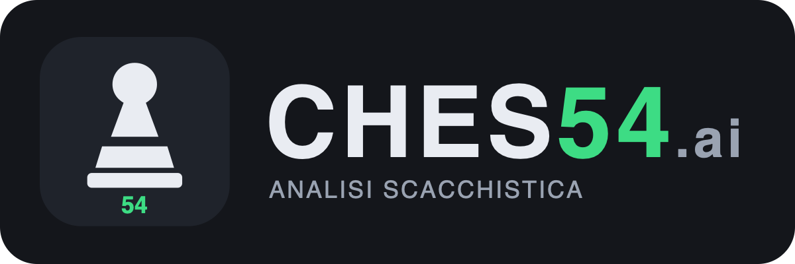

<p align="center"></p>

# ♟ CHES54.ai

Analisi scacchistica nel browser. Inserisci le mosse tue e del tuo avversario e CHES54.ai ti mostra le **5 mosse migliori**, con valutazione, linea prevista e una breve spiegazione in italiano.

Il motore è **Stockfish 17.1** (versione WebAssembly "lite"). Gira direttamente sul tuo dispositivo: non servono server, account o abbonamenti, e dopo il primo caricamento funziona anche offline.

---

## 1. Avviare l'app sul computer

**Mac (il modo più semplice):** fai doppio clic su **`Avvia CHES54.command`**.
La prima volta macOS potrebbe bloccarlo. In quel caso fai clic destro sul file → **Apri** → **Apri**.

Si apre una finestra del Terminale con gli indirizzi, e il browser si apre da solo su `http://localhost:5454`.

**Windows:** doppio clic su **`Avvia CHES54.bat`**. Serve Python, che puoi scaricare gratis da https://www.python.org/downloads/ (durante l'installazione spunta "Add Python to PATH").

**Da terminale:**
```bash
cd ches54-ai
python3 server.py        # oppure: npm start
```

> ⚠️ Non aprire `index.html` con un doppio clic: il motore funziona solo tramite il server (`http://…`), non da `file://`.

> 💡 Tieni la cartella in una posizione **non sincronizzata con iCloud o OneDrive** (per esempio la cartella Inizio). Se la Scrivania è sincronizzata, macOS può spostare i file nel cloud e l'app smette di funzionare finché non vengono riscaricati.

Per chiudere l'app chiudi la finestra del Terminale, oppure premi `Ctrl + C`.

## 2. Usarla dal telefono (stessa rete Wi-Fi)

1. Avvia l'app sul computer come descritto al punto 1.
2. Nella finestra del Terminale leggi la riga **«Sul telefono: http://192.168.x.x:5454»**.
3. Apri quell'indirizzo nel browser del telefono, che deve essere collegato allo **stesso Wi-Fi** del computer.

Se non si apre, al primo avvio il Mac potrebbe chiederti di consentire a Python le connessioni in entrata: scegli **Consenti**.

## 3. Pubblicarla online e condividerla con un link

Così l'app funziona ovunque, anche senza computer acceso, e si può **installare sul telefono** come un'app vera (in rete locale questo non è possibile perché serve HTTPS).

### Opzione A – Netlify Drop (2 minuti, senza account GitHub)
1. Vai su https://app.netlify.com/drop e crea un account gratuito.
2. Trascina l'intera cartella `ches54-ai` nella pagina.
3. Ottieni un link tipo `https://nome-a-caso.netlify.app`. Puoi cambiarlo in *Site settings → Change site name*, per esempio in `ches54-ai.netlify.app`.

### Opzione B – GitHub Pages
1. Crea un repository su https://github.com/new chiamato `ches54-ai`.
2. Dentro la cartella del progetto esegui:
   ```bash
   git init
   git add .
   git commit -m "CHES54.ai"
   git branch -M main
   git remote add origin https://github.com/TUO-UTENTE/ches54-ai.git
   git push -u origin main
   ```
3. Su GitHub apri **Settings → Pages**. In *Source* scegli **Deploy from a branch**, poi **main** e la cartella **/ (root)**, e premi **Save**.
4. Dopo circa un minuto l'app è online su `https://TUO-UTENTE.github.io/ches54-ai/`.

### Installarla sul telefono
Apri il link online e poi:
- **iPhone (Safari):** tasto Condividi → **Aggiungi alla schermata Home**.
- **Android (Chrome):** menu ⋮ → **Installa app** (oppure *Aggiungi a schermata Home*).

L'icona CHES54 compare tra le tue app e funziona anche offline.

## 4. Come si usa

1. All'avvio scegli il tuo colore. La scacchiera si orienta con i tuoi pezzi in basso.
2. Inserisci le mosse in uno di questi modi:
   - **trascinando** un pezzo, oppure **toccando** il pezzo e poi la casa di arrivo;
   - **scrivendo** la mossa nel campo di testo e premendo *Gioca*.
3. Dopo ogni mossa compaiono le mosse migliori per chi deve muovere:
   - ⭐ la migliore è evidenziata e sulla scacchiera ha una **freccia verde**, le alternative hanno frecce azzurre;
   - passando sopra una mossa la sua freccia si illumina, toccandola la giochi;
   - le valutazioni sono **dal tuo punto di vista** (+ significa che sei in vantaggio, − che sei in svantaggio).
4. **Veloce / Normale / Profonda** regolano la profondità di analisi (12 / 16 / 20 semimosse). "Profonda" è più precisa ma più lenta sul telefono.
5. Gli altri pulsanti:
   - **Annulla** toglie l'ultima mossa;
   - **Gira** ruota la scacchiera;
   - **FEN / PGN** copia o carica una posizione o una partita intera;
   - **Nuova partita** ricomincia;
   - **◐** in alto cambia il tema (chiaro o scuro).

La partita in corso viene salvata automaticamente nel browser.

### Notazione accettata nel campo di testo
| Esempio | Significato |
|---|---|
| `d3`, `e5`, `exd5` | mosse di pedone |
| `Cf3`, `Ac4`, `Te1`, `Dh5`, `Re2` | pezzi in italiano: **C**avallo, **A**lfiere, **T**orre, **D**onna, **R**e |
| `Nf3`, `Bc4`, `Qh5` | anche la notazione inglese va bene |
| `O-O`, `0-0-0` | arrocco corto e lungo |
| `d2d3`, `g1-f3` | casa di partenza e casa di arrivo |
| `e8=D`, `e7e8d` | promozione |

## 5. Verifica rapida

1. Avvia l'app e scegli **Bianco**.
2. Scrivi `d3` e premi Gioca, poi scrivi `e5` (la mossa del Nero).
3. Devi vedere: lo storico `1. d3 e5`, il riquadro «Le tue mosse migliori» con 5 mosse (di solito c4, Cf3, e4…), la profondità che arriva a `16/16 ✓` e una freccia verde sulla scacchiera.

Test automatici della logica (servono Node.js):
```bash
npm test
```

## Struttura del progetto

```
ches54-ai/
├── logo-CHES54.png        logo (anche in versione vettoriale: logo-CHES54.svg)
├── index.html             interfaccia
├── style.css              grafica (tema scuro e chiaro, layout mobile-first)
├── js/
│   ├── app.js             logica principale
│   ├── board.js           scacchiera: trascinamento, tocco, frecce, animazioni
│   ├── engine.js          comunicazione con Stockfish (Web Worker, MultiPV)
│   ├── notation.js        notazione italiana e lettura delle mosse scritte
│   └── explain.js         spiegazioni in italiano delle mosse
├── lib/chess.js           regole degli scacchi (chess.js 1.4.0)
├── engine/                Stockfish 17.1 lite (WebAssembly, single-thread)
├── pieces/                pezzi SVG (set "cburnett")
├── icons/                 icone dell'app
├── manifest.webmanifest   + sw.js → installabile e offline (PWA)
├── server.py              server locale (computer + rete Wi-Fi)
├── Avvia CHES54.command   avvio con doppio clic su Mac
└── Avvia CHES54.bat       avvio con doppio clic su Windows
```

Non c'è nessuna fase di build: i file vengono serviti così come sono. Se modifichi qualcosa e l'app è già installata sul telefono, cambia `VERSION` in `sw.js` così il telefono scarica la nuova versione.

## Crediti e licenze
- [Stockfish](https://stockfishchess.org/) (GPL-3.0), versione JavaScript di [nmrugg/stockfish.js](https://github.com/nmrugg/stockfish.js)
- [chess.js](https://github.com/jhlywa/chess.js) (BSD-2-Clause)
- Pezzi "cburnett" di Colin M.L. Burnett (CC BY-SA 3.0), dal progetto [lichess](https://github.com/lichess-org/lila)

Poiché Stockfish è GPL-3.0, se pubblichi l'app rendi disponibile anche il codice sorgente: su GitHub Pages lo è già.

---

*CHES54.ai è uno strumento di analisi e allenamento. Usarlo durante partite online o tornei in corso è contro il regolamento delle piattaforme e delle federazioni.*
